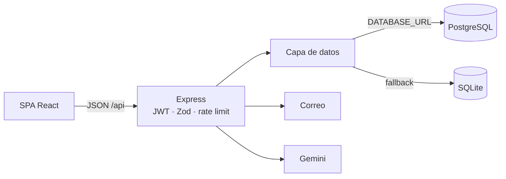

<div align="center">

# Nimbo ERP

**Sistema de gestión empresarial full-stack para la nube** — Punto de venta, inventario, compras, producción, contabilidad y RRHH, orientado a PYMES cubanas.

[](https://github.com/JordanBV1/nimbo-erp/actions/workflows/ci.yml)
[](LICENSE)
[](https://nodejs.org)
[](https://www.typescriptlang.org)

</div>

## Descripción

Nimbo ERP es una aplicación full-stack (React + Express + PostgreSQL) para administrar un negocio completo desde el navegador: ventas en el punto de venta, inventario y stock multi-almacén, pedidos y delivery, compras a proveedores, clientes con crédito y fidelidad, producción por recetas, contabilidad de doble entrada, recursos humanos, reportes fiscales y suscripción mensual del servicio.

Incluye registro de organizaciones con prueba gratuita, onboarding guiado, aislamiento multi-tenant, auditoría de acciones, exportación de datos (CSV/JSON), centro de ayuda con tickets y recibo de pago en PDF.

## Funcionalidades

- **Dashboard** con métricas del negocio y estado de la suscripción
- **Punto de venta (POS)** con múltiples formas de pago, cierre de caja y QR de Transfermóvil
- **Catálogo** de productos con variantes, impuestos y precios en CUP/USD
- **Inventario** multi-almacén con mínimos, transferencias y trazabilidad de movimientos
- **Pedidos y delivery** con estados y anticipos
- **Compras y proveedores** con órdenes, recepción de mercancía y facturas
- **Clientes** con cuentas por cobrar, crédito y puntos de fidelidad
- **Producción** con recetas, consumo de ingredientes y producto terminado
- **Contabilidad** de doble entrada, movimientos de caja y reporte fiscal ONAT
- **Recursos humanos** con empleados, asistencia y nóminas
- **Suscripción mensual** con pago por Transfermóvil/EnZona, confirmación por el administrador y recibo PDF
- **Multi-tenant** con roles por sucursal y organización
- **Cola offline** que sincroniza ventas al recuperar la conexión
- **Auditoría**, onboarding, centro de ayuda, exportación de datos y páginas legales

## Stack

| Capa | Tecnología |
| --- | --- |
| Frontend | React 19, TypeScript 5.8, Tailwind CSS 4, Vite 6, Recharts, jsPDF |
| Backend | Node.js 20+, Express 4, TypeScript, Zod |
| Base de datos | PostgreSQL en Supabase (SQLite con `better-sqlite3` en desarrollo) |
| Autenticación | JWT HS256 + bcrypt |
| Correo | Gmail API / EmailJS / SMTP |
| IA | Google Gemini (`@google/genai`) |
| Observabilidad | pino + pino-http |
| Testing | Vitest + Supertest |
| CI/CD | GitHub Actions + Render (`render.yaml`, Dockerfile) |

## Arquitectura

Un monolito modular: un único servidor Express sirve la API REST (66 endpoints) y la SPA compilada. La capa de datos es intercambiable — PostgreSQL cuando existe `DATABASE_URL`, SQLite en caso contrario — detrás de una interfaz común.



El detalle completo (diagramas de secuencia, modelo de datos, multi-tenancy y decisiones de diseño) está en **[docs/ARCHITECTURE.md](docs/ARCHITECTURE.md)**.

## Requisitos

- Node.js 20 o superior
- npm 10 o superior

## Instalación

```bash
git clone https://github.com/JordanBV1/nimbo-erp.git
cd nimbo-erp
npm ci
cp .env.example .env
```

Configura `.env` (ver [Variables de entorno](#variables-de-entorno)).

## Ejecutar en desarrollo

```bash
npm run dev
```

Arranca Express con Vite integrado en `http://localhost:3000`. Sin `DATABASE_URL`, se crea y siembra automáticamente `db-data/nimbo.db` la primera vez.

## Pruebas

```bash
npm test
```

Vitest ejecuta la API con Supertest sobre una base temporal aislada (`db-data/nimbo-test.db`), que se elimina al terminar. La integración continua ejecuta tipos, tests y build en cada push y pull request.

## Build y producción

```bash
npm run build   # tsc --noEmit + vite build + bundle del servidor
npm start       # node dist/server.cjs
```

El servidor sirve el frontend compilado y crea respaldos automáticos diarios en `db-data/backups/` (retención de 7 copias).

## Variables de entorno

Ver [`.env.example`](.env.example). En desarrollo todas son opcionales; en producción `JWT_SECRET` y `APP_URL` son obligatorias (el servidor no arranca sin ellas).

| Variable | Descripción | Obligatoria |
| --- | --- | --- |
| `NODE_ENV` | `development` o `production` | Sí (prod) |
| `PORT` | Puerto del servidor (por defecto `3000`) | No |
| `JWT_SECRET` | Clave para firmar tokens JWT | Sí (prod) |
| `APP_URL` | URL pública (CORS, CSP, enlaces de correo) | Sí (prod) |
| `DATABASE_URL` | Cadena de conexión PostgreSQL (Supabase) | No (usa SQLite si falta) |
| `TRIAL_DAYS` | Días de prueba para organizaciones nuevas | No |
| `GEMINI_API_KEY` | Clave de Google Gemini (asistente IA) | No |
| `SMTP_*` | Envío por SMTP | No |
| `GMAIL_*` | Envío por Gmail API (HTTPS 443) | No |
| `EMAILJS_*` | Envío por EmailJS (sin SMTP) | No |

### Correo

Prioridad de transporte: `GMAIL_*` → `EMAILJS_*` → `SMTP_*`. En el plan gratuito de Render los puertos SMTP están bloqueados, por eso se recomienda Gmail API o EmailJS. Si no hay transporte configurado, la app muestra el enlace de recuperación en pantalla para reenviarlo manualmente.

### Configuración de negocio

Desde el módulo Configuración: nombre del negocio, precio base y por local de la suscripción, teléfono de Transfermóvil, correo de soporte y datos fiscales para ONAT.

## Credenciales demo

En una base recién sembrada (primer arranque en desarrollo) se crean usuarios de ejemplo con contraseña `123456`:

| Correo | Rol |
| --- | --- |
| `admin@nimbo.com` | SUPER_ADMIN (operador de plataforma) |
| `admin@bakery.com` | ADMIN de panadería |
| `admin@ropa.com` | GERENTE de tienda de ropa |
| `cajero@ropa.com` | CAJERO |

> En producción la base se limpia al lanzar: solo queda la cuenta de propietario con rol `SUPER_ADMIN` y contraseña temporal que debe cambiarse en el primer acceso.

## Despliegue en Render

El repositorio incluye un blueprint (`render.yaml`). Un push a `master` dispara el despliegue:

- **Build**: `npm ci && npm run build`
- **Start**: `node dist/server.cjs`
- **Variables**: `NODE_ENV=production`, `APP_URL`, `JWT_SECRET` (autogenerada), `PORT=10000`, `TRIAL_DAYS`
- **Base de datos**: PostgreSQL en Supabase. La `DATABASE_URL` se configura desde el panel de Render (`sync: false`) para no exponer credenciales en el repositorio.

### Confirmación de pagos

El cliente reporta su pago y queda **pendiente**. Un `SUPER_ADMIN` lo confirma o rechaza desde **Suscripción → Pagos pendientes**. Solo al confirmarlo se activa o renueva la suscripción por 30 días.

## Documentación

| Documento | Contenido |
| --- | --- |
| [Arquitectura](docs/ARCHITECTURE.md) | Componentes, flujos, modelo de datos, seguridad |
| [Referencia de API](docs/API.md) | Los 66 endpoints con accesos y ejemplos |
| [Manual técnico](docs/MANUAL_TECNICO.md) | Instalación, variables, despliegue, respaldos |
| [Manual de usuario](docs/MANUAL_USUARIO.md) | Guía funcional por módulo |
| [ADRs](docs/adr/) | Decisiones de arquitectura |
| [Changelog](CHANGELOG.md) | Historial de versiones |

## Estructura del proyecto

```
server.ts                 # Express: middleware, 66 rutas, auth, validación
src/
  App.tsx                 # Composición de la SPA
  components/             # Vistas por módulo (POS, inventario, landing, ...)
  db/
    db.ts                 # Interfaz de datos + implementación SQLite
    pg-db.ts              # Implementación PostgreSQL
    pg.ts                 # Pool y traducción de SQL
    backup.ts             # Respaldos automáticos
  mailer.ts               # Gmail API / EmailJS / SMTP
  logger.ts               # pino + pino-http
  types.ts                # Roles, monedas y tipos de dominio
  utils/offlineQueue.ts   # Cola offline del navegador
tests/                    # Vitest + Supertest
docs/                     # Arquitectura, API, manuales y ADRs
.github/workflows/ci.yml  # Integración continua
Dockerfile                # Imagen multi-etapa
render.yaml               # Blueprint de despliegue
```

## Seguridad

- Cabeceras con `helmet` y CSP; CORS restringido a `APP_URL` en producción.
- Rate limiting: 20 intentos/15 min en autenticación y 200 req/min en la API.
- Contraseñas con bcrypt (10 rondas); token JWT de 24 h guardado en memoria.
- Toda consulta de negocio filtra por `organization_id` derivado del token.
- Validación de entrada con Zod y registro de auditoría en acciones sensibles.

## Licencia

Distribuido bajo la licencia **Apache 2.0**. Consulta [LICENSE](LICENSE).
