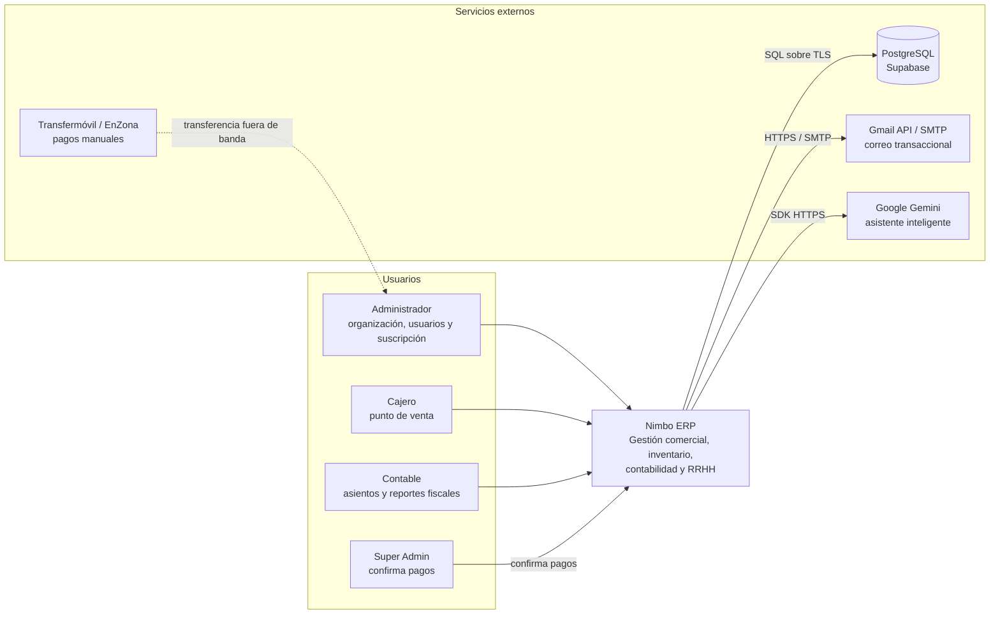
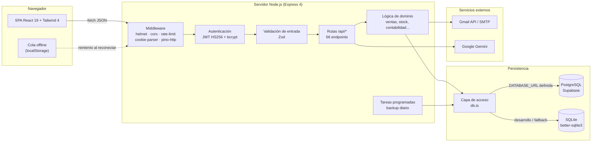
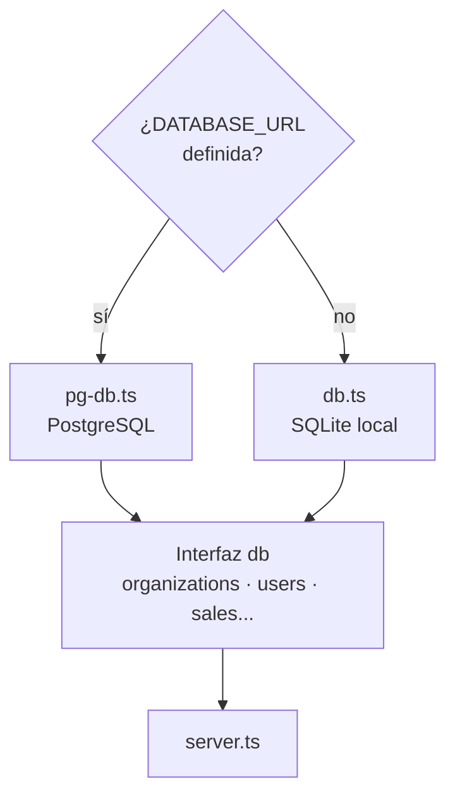
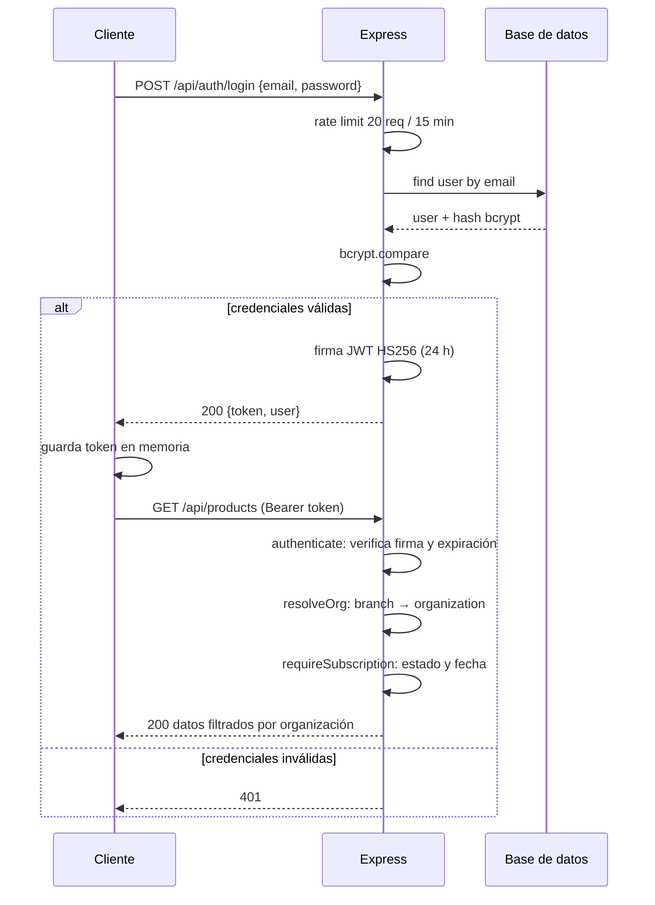
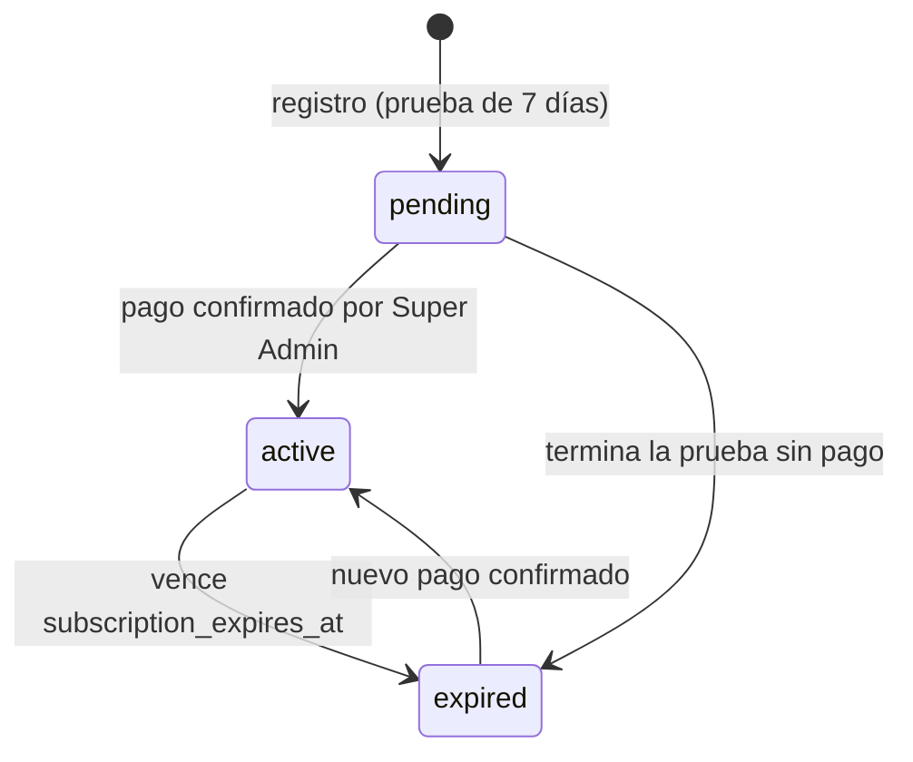
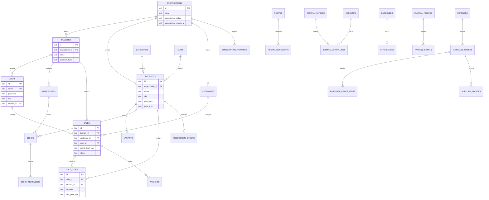
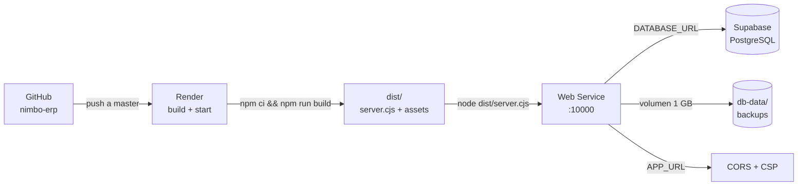

# Arquitectura de Nimbo ERP

Este documento describe la arquitectura técnica del sistema: componentes, flujos, modelo de datos y decisiones de diseño.

## 1. Visión general

Nimbo ERP es una aplicación **monolítica modular full-stack**: un único servidor Express sirve la API REST y, en producción, también los assets estáticos generados por Vite. El frontend es una SPA en React que consume la API bajo `/api`.

## 2. Contenedores y capas

| Capa | Archivos | Responsabilidad |
| --- | --- | --- |
| Presentación | `src/App.tsx`, `src/components/**` | Vistas, estado de UI, cliente de API |
| Composición del servidor | `server.ts` | Middleware, rutas, autenticación, validación |
| Acceso a datos | `src/db/db.ts`, `src/db/pg-db.ts`, `src/db/pg.ts` | Colecciones y SQL para 38 tablas |
| Servicios de infraestructura | `src/mailer.ts`, `src/logger.ts`, `src/db/backup.ts` | Correo, logging estructurado, respaldos |
| Cliente offline | `src/utils/offlineQueue.ts` | Cola de acciones pendientes en el navegador |

### Selección de motor de base de datos

`src/db/db.ts` expone una única interfaz `db` cuyas implementaciones son intercambiables:

- En producción se define `DATABASE_URL` y se usa PostgreSQL.
- En desarrollo, sin esa variable, se crea y siembra `db-data/nimbo.db` automáticamente.
- `pg.ts` traduce los placeholders `?` del estilo SQLite a `$1..$n` de PostgreSQL, lo que permite compartir las consultas SQL entre ambos motores.

## 3. Autenticación y autorización

Controles:

- **JWT firmado con HS256** y expiración de 24 horas. En producción el servidor se niega a arrancar sin `JWT_SECRET`.
- **bcrypt** con 10 rondas para almacenar contraseñas; nunca se devuelve el hash al cliente.
- **Token en memoria**, no en `localStorage`, para reducir el impacto de XSS. Se acepta también en cookie `token`.
- **Roles** (`SUPER_ADMIN`, `ADMIN`, `GERENTE`, `CAJERO`, `BODEGA`, `PRODUCCION`, `CONTABLE`, `RRHH`) mediante el middleware `authorize(...roles)`.
- **Multi-tenant**: cada usuario pertenece a una sucursal; la sucursal pertenece a una organización. `resolveOrg` deriva `req.orgId` en cada petición y todas las consultas filtran por ese identificador.

## 4. Ciclo de vida de la suscripción

1. El usuario reporta un pago desde la app indicando plataforma, teléfono y número de transacción.
2. El pago queda en estado `pending`; el acceso a los módulos sigue bloqueado si la suscripción no está activa.
3. Un `SUPER_ADMIN` revisa y confirma (`verified`) o rechaza (`rejected`).
4. Al confirmar se extienden 30 días desde la fecha de vencimiento vigente (o desde hoy si ya venció).

Precio: base de 5 000 CUP + 1 000 CUP por cada sucursal adicional, configurable en `system_settings`.

## 5. Modelo de datos

38 tablas agrupadas por módulo:

| Módulo | Tablas |
| --- | --- |
| Organización y acceso | `organizations`, `branches`, `users`, `password_reset_tokens`, `audit_logs`, `system_settings`, `support_tickets`, `subscription_payments` |
| Catálogo | `categories`, `taxes`, `products`, `variants` |
| Inventario | `warehouses`, `stocks`, `stock_movements`, `transfers` |
| Compras | `suppliers`, `purchase_orders`, `purchase_order_items`, `supplier_invoices` |
| Ventas | `customers`, `sales`, `sale_items`, `payments`, `cash_register_sessions`, `cash_register_transactions` |
| Pedidos | `orders`, `order_items` |
| Producción | `recipes`, `recipe_ingredients`, `production_orders` |
| Contabilidad | `accounts`, `journal_entries`, `journal_entry_lines` |
| RRHH | `employees`, `attendances`, `payroll_periods`, `payroll_details` |

### Núcleo comercial

Convenciones:

- Claves primarias `TEXT` generadas por la aplicación (UUID-like), lo que evita secuencias y facilita la sincronización offline.
- Importes monetarios en `DOUBLE PRECISION` con columnas separadas para CUP y USD.
- Fechas en ISO 8601 (`TEXT`) para mantener compatibilidad entre SQLite y PostgreSQL.
- `organization_id` en toda entidad de negocio: primera línea de aislamiento multi-tenant.

## 6. Punto de venta y sincronización offline

El POS puede operar con conectividad intermitente:

1. Si una venta falla por red, el cliente encola la petición en `localStorage` (`nimbo_offline_sync_queue`).
2. El Header muestra el número de acciones pendientes.
3. Al reconectar se reenvían en orden; si una falla por red se detiene para no perder el orden.
4. Al confirmarse la respuesta, la acción se elimina de la cola.

## 7. Despliegue

- **Build**: `tsc --noEmit` (lint de tipos) → `vite build` → bundle del servidor con esbuild (`dist/server.cjs`).
- **Proceso**: un solo servicio Node; sirve API y SPA.
- **Respaldos**: en producción, un job en proceso crea un volcado cada 24 h (`.db` en SQLite, `.json` por tabla en PostgreSQL) y conserva los 7 más recientes.
- **Salud**: `GET /api/health` informa estado del proceso, base de datos y versión.

## 8. Seguridad

| Control | Implementación |
| --- | --- |
| Cabeceras HTTP | `helmet` con CSP, `frame-ancestors: none`, `base-uri: self` |
| CORS | Restringido a `APP_URL` en producción |
| Fuerza bruta | 20 intentos / 15 min en `/api/auth` |
| Abuso de API | 200 peticiones / min por IP |
| Validación | Esquemas Zod en las rutas de escritura |
| Contraseñas | bcrypt, 10 rondas |
| Sesión | JWT 24 h, secreto obligatorio en producción |
| Multi-tenancy | Filtro por `organization_id` derivado del token, no del cliente |
| Auditoría | `audit_logs` para acciones sensibles |
| Límite de cuerpo | 10 MB |
| XSS | Token en memoria; React escapa por defecto |

Limitaciones conocidas:

- La confirmación de pagos de suscripción es manual (no hay webhook bancario).
- El rate limiting es en memoria: con varias instancias haría falta un almacén compartido.
- No se aplica Content-Security-Policy estricta sin `unsafe-inline`, requerida por Tailwind en runtime de desarrollo.

## 9. Decisiones de arquitectura

Las decisiones relevantes están registradas en [`docs/adr/`](adr/):

- [ADR-001](adr/001-postgresql-supabase.md): PostgreSQL en producción y SQLite en desarrollo.
- [ADR-002](adr/002-jwt-autenticacion.md): autenticación con JWT en lugar de sesiones en servidor.
- [ADR-003](adr/003-monolito-modular.md): monolito modular en lugar de microservicios.
- [ADR-004](adr/004-confirmacion-manual-pagos.md): verificación manual de pagos de suscripción.
